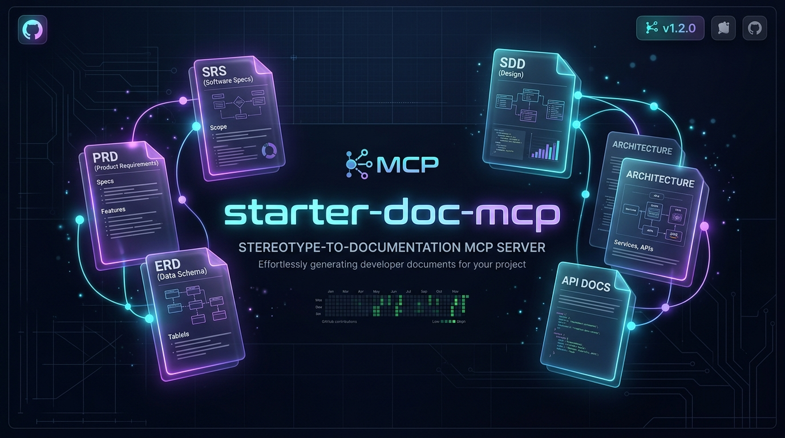

<p align="center">
  
</p>

# starter-doc-mcp

[](https://github.com/zifaucode/starter-doc-mcp/actions/workflows/ci.yml)
[](LICENSE)
[](https://nodejs.org)
[](https://modelcontextprotocol.io)

Server [Model Context Protocol](https://modelcontextprotocol.io) yang menghasilkan dokumen rekayasa perangkat lunak (PRD, SRS, ERD, SDD, DESIGN, matriks keterlacakan, dan instruksi agen) sebagai Markdown, supaya agen coding membangun dari spesifikasi tertulis dan tidak menebak.

Prinsip utamanya: **yang tidak diberikan tidak dikarang.** Bagian yang belum kamu isi tampil sebagai `[NOT SUPPLIED]` atau `UNMAPPED`, bukan diisi data palsu.

## Isi

- [Pilih jalur instalasi](#pilih-jalur-instalasi)
- [Jalur A: pakai versi GitHub (tanpa clone)](#jalur-a-pakai-versi-github-tanpa-clone)
- [Jalur B: clone proyek](#jalur-b-clone-proyek)
- [Daftarkan ke editor](#daftarkan-ke-editor)
- [Cek bahwa sudah berhasil](#cek-bahwa-sudah-berhasil)
- [Jika ada masalah](#jika-ada-masalah)
- [Memperbarui dan menghapus](#memperbarui-dan-menghapus)
- [Cara memanggil](#cara-memanggil)
- [Di mana file disimpan](#di-mana-file-disimpan)
- [Tool yang tersedia](#tool-yang-tersedia)
- [Dokumen yang dihasilkan](#dokumen-yang-dihasilkan)
- [Mode lite dan full](#mode-lite-dan-full)
- [Preset](#preset)
- [Batasan](#batasan)
- [Pengembangan](#pengembangan)

## Pilih jalur instalasi

Ada dua cara memasang server ini. Pilih satu.

| | Jalur A: versi GitHub | Jalur B: clone proyek |
| :--- | :--- | :--- |
| Cocok untuk | Pengguna biasa yang hanya ingin memakai | Yang ingin membaca atau mengubah kode |
| Perlu Git | Tidak | Ya |
| Langkah | 2 | 5 |
| Pembaruan | Hapus cache, lalu mulai ulang editor | `git pull`, lalu build ulang |
| Start pertama | Sekitar 20 detik (npm mengunduh dan membangun), berikutnya sekitar 4 detik | Cepat |

Kalau ragu, pakai Jalur A.

### Yang perlu disiapkan dulu

**Node.js 18 atau lebih baru.** Cek di terminal (PowerShell di Windows, Terminal di macOS dan Linux):

```bash
node --version
```

Hasilnya harus `v18.x.x` atau lebih tinggi. Jika muncul `node is not recognized` atau versinya lebih rendah, pasang versi LTS dari [nodejs.org](https://nodejs.org), **tutup lalu buka lagi terminal dan editor-mu**, lalu cek ulang. `npm` dan `npx` ikut terpasang bersama Node.js.

**Git**, hanya untuk Jalur B. Cek dengan `git --version`. Jika belum ada, unduh dari [git-scm.com](https://git-scm.com).

## Jalur A: pakai versi GitHub (tanpa clone)

**Langkah 1. Coba jalankan sekali di terminal** supaya npm mengunduh dan membangunnya lebih dulu:

```bash
npx -y github:zifaucode/starter-doc-mcp
```

Yang akan terjadi: setelah 10 sampai 30 detik muncul satu baris `starter-doc-mcp server running on stdio`, lalu terminal diam. Itu normal. Server sedang menunggu perintah dari editor, bukan macet. Tekan `Ctrl+C` untuk keluar.

Langkah ini penting. Sebagian editor menyerah jika server tidak menjawab dalam beberapa detik, dan unduhan pertama bisa lebih lama dari itu. Setelah dijalankan sekali, cache npm membuat start berikutnya sekitar 4 detik.

**Langkah 2.** Lanjut ke [Daftarkan ke editor](#daftarkan-ke-editor) dan pakai bentuk **Jalur A (npx)**.

## Jalur B: clone proyek

**Langkah 1. Pilih folder yang tetap.** Jangan di folder Downloads atau folder sementara, karena editor akan menunjuk ke sini selamanya. Contoh: `D:\tools` di Windows atau `~/tools` di macOS dan Linux.

**Langkah 2. Clone:**

```bash
cd D:\tools
git clone https://github.com/zifaucode/starter-doc-mcp.git
cd starter-doc-mcp
```

**Langkah 3. Pasang dependensi:**

```bash
npm install
```

Perintah ini juga langsung membangun proyek (lewat script `prepare`). Tidak ada dependensi global.

**Langkah 4. Pastikan hasil build ada:**

```bash
npm run build
```

Keluaran akhirnya harus memuat `Build success`, dan file `dist/index.js` sekarang ada. Jalankan ulang perintah ini setiap kali kamu mengubah kode atau menarik pembaruan.

**Langkah 5. Catat path lengkap `dist/index.js`.** Kamu butuh ini di langkah pendaftaran.

```powershell
# Windows (PowerShell)
(Resolve-Path dist\index.js).Path
```

```bash
# macOS dan Linux
realpath dist/index.js
```

Contoh hasil: `D:\tools\starter-doc-mcp\dist\index.js`. Saat menulisnya di berkas JSON, pakai garis miring biasa agar tidak perlu menggandakan backslash: `D:/tools/starter-doc-mcp/dist/index.js`.

Uji cepat (opsional): `node dist/index.js` harus mencetak `starter-doc-mcp server running on stdio` lalu menunggu. Tekan `Ctrl+C` untuk keluar.

Lanjut ke [Daftarkan ke editor](#daftarkan-ke-editor) dan pakai bentuk **Jalur B (node)**.

## Daftarkan ke editor

Server ini berbicara lewat stdio. Tidak ada port, akun, atau variabel lingkungan yang perlu diisi. Yang perlu kamu beri tahu editor hanyalah perintah untuk menjalankannya.

### Bentuk konfigurasi

Hampir semua editor memakai bentuk `mcpServers` ini. Pilih **satu** blok sesuai jalurmu.

**Jalur A (npx):**

```json
{
  "mcpServers": {
    "starter-doc-mcp": {
      "command": "npx",
      "args": ["-y", "github:zifaucode/starter-doc-mcp"]
    }
  }
}
```

**Jalur B (node)**, ganti path dengan hasil Langkah 5:

```json
{
  "mcpServers": {
    "starter-doc-mcp": {
      "command": "node",
      "args": ["D:/tools/starter-doc-mcp/dist/index.js"]
    }
  }
}
```

Jika berkas konfigurasimu sudah punya `mcpServers`, **jangan menimpa**. Tambahkan `"starter-doc-mcp": { ... }` di dalamnya, dipisah koma dari server lain.

### Lokasi berkas per editor

| Editor | Berkas konfigurasi | Catatan |
| :--- | :--- | :--- |
| Claude Desktop | Windows: `%APPDATA%\Claude\claude_desktop_config.json`<br>macOS: `~/Library/Application Support/Claude/claude_desktop_config.json` | Bisa dibuka dari Settings, Developer, Edit Config. Setelah menyimpan, **keluar total** dari aplikasi (termasuk ikon di tray) lalu buka lagi. |
| Cursor | Semua proyek: `~/.cursor/mcp.json`<br>Satu proyek: `.cursor/mcp.json` di folder proyek | Aktifkan di Settings, MCP. |
| Windsurf | `~/.codeium/windsurf/mcp_config.json` | Muat ulang dari panel MCP. |
| Cline, Roo Code | Buka dari panel MCP Servers, Configure MCP Servers | Bentuk JSON sama. |
| Zed | Windows: `%APPDATA%\Zed\settings.json`<br>macOS dan Linux: `~/.config/zed/settings.json` | Bentuknya berbeda, lihat di bawah. |
| Claude Code | Lewat perintah `claude mcp add` | Lihat di bawah. |

`~` berarti folder home-mu. `%APPDATA%` di Windows biasanya `C:\Users\<namamu>\AppData\Roaming`. Tempel `%APPDATA%\Claude` di bilah alamat File Explorer untuk membukanya.

### Zed

Buka command palette (`Ctrl+Shift+P`), ketik `zed: open settings`, lalu tambahkan di dalam objek utama. Jika `context_servers` sudah ada, tambahkan entrinya di dalam yang ada.

Jalur A:

```json
"context_servers": {
  "starter-doc-mcp": {
    "enabled": true,
    "remote": false,
    "command": "npx",
    "args": ["-y", "github:zifaucode/starter-doc-mcp"]
  }
}
```

Jalur B:

```json
"context_servers": {
  "starter-doc-mcp": {
    "enabled": true,
    "remote": false,
    "command": "node",
    "args": ["D:\\tools\\starter-doc-mcp\\dist\\index.js"]
  }
}
```

Zed memakai JSON dengan komentar, jadi jangan heran melihat baris `//` di berkas itu. Pada contoh Jalur B di atas, backslash digandakan karena itu aturan string JSON. Garis miring biasa (`D:/tools/...`) juga bisa dipakai.

Setelah menyimpan, buka panel Agent, buka pengaturannya, dan cari `starter-doc-mcp`. Titik hijau berarti server berjalan.

### Claude Code

Jalur A:

```bash
claude mcp add --scope user starter-doc-mcp -- npx -y github:zifaucode/starter-doc-mcp
```

Di Windows asli (bukan WSL), bungkus dengan `cmd /c`:

```bash
claude mcp add --scope user starter-doc-mcp -- cmd /c npx -y github:zifaucode/starter-doc-mcp
```

Jalur B:

```bash
claude mcp add --scope user starter-doc-mcp -- node D:/tools/starter-doc-mcp/dist/index.js
```

`--scope user` membuat server tersedia di semua proyekmu. Tanpa opsi itu, server hanya berlaku untuk folder tempat kamu menjalankan perintah. Periksa dengan `claude mcp list`. Statusnya harus `Connected`.

## Cek bahwa sudah berhasil

1. **Mulai ulang editor** (atau muat ulang server MCP-nya) setelah menyimpan konfigurasi.
2. **Pastikan server tampil sebagai aktif** di panel MCP milik editor. Zed menampilkan titik hijau, `claude mcp list` menampilkan `Connected`.
3. **Pancing satu panggilan.** Ketik di chat asisten:

   ```
   Pakai starter-doc-mcp, tampilkan list_blueprint_templates.
   ```

   Hasil yang benar adalah daftar tiga preset: `saas-b2b`, `ecommerce`, dan `ai-agent-platform`. Editor mungkin meminta persetujuan memakai tool, dan kamu bisa menyetujuinya.

4. **Coba buat dokumen kecil** dengan menyebut folder tujuan secara lengkap:

   ```
   Pakai starter-doc-mcp, buat SRS saja untuk "Tes", deskripsi "aplikasi uji coba",
   fitur: login. Mode lite. Simpan ke D:\proyek\tes\SRS.md
   ```

   Balasan harus memuat baris `Full path:` berisi lokasi file. Buka path itu dan pastikan filenya ada.

Jika langkah 3 gagal, lihat bagian di bawah.

## Jika ada masalah

| Gejala | Penyebab umum | Cara memperbaiki |
| :--- | :--- | :--- |
| Server tidak muncul atau berwarna merah | Perintah gagal dijalankan | Jalankan perintah yang sama di terminal (`npx -y github:zifaucode/starter-doc-mcp` atau `node <path>/dist/index.js`) dan baca pesan galatnya. |
| `node is not recognized` atau `npx is not recognized` | Node.js belum terpasang, atau editor dibuka sebelum Node dipasang | Pasang Node.js LTS, lalu tutup dan buka lagi editor. |
| `spawn npx ENOENT` (umum di Windows) | Editor tidak menemukan `npx` | Ganti konfigurasi menjadi `"command": "cmd", "args": ["/c", "npx", "-y", "github:zifaucode/starter-doc-mcp"]`. |
| `Cannot find module ...dist/index.js` | Jalur B: belum dibuild, atau path salah | Jalankan `npm run build` di folder proyek, lalu cek path dengan `(Resolve-Path dist\index.js).Path`. |
| Server mati sendiri saat pertama dijalankan (Jalur A) | Unduhan pertama terlalu lama untuk batas waktu editor | Jalankan Langkah 1 Jalur A di terminal sekali, lalu mulai ulang editor. |
| Server aktif, tetapi asisten tidak memakainya | Model tidak mendukung tool, atau tool belum aktif untuk profil asisten | Pakai model yang mendukung tool use. Di Zed, cek tool apa saja yang aktif untuk profil Agent yang dipakai. Sebut juga namanya: "pakai tool `generate_full_blueprint` dari starter-doc-mcp". |
| File tersimpan di tempat yang tidak kuduga | Folder tujuan tidak disebut lengkap | Lihat [Di mana file disimpan](#di-mana-file-disimpan). |
| `npm install` gagal | Versi Node di bawah 18, atau koneksi terputus | Cek `node --version`, lalu coba lagi. |

Jika masalahmu tidak ada di tabel, buka [issue](https://github.com/zifaucode/starter-doc-mcp/issues) dengan menyertakan sistem operasi, editor yang dipakai, jalur instalasi, dan pesan galat lengkapnya.

## Memperbarui dan menghapus

### Jalur A (GitHub)

npm menyimpan salinan di cache, jadi editor bisa terus memakai versi lama. Untuk mengambil yang terbaru, hapus cache npx, lalu mulai ulang editor:

```powershell
# Windows (PowerShell)
Remove-Item -Recurse -Force (Join-Path (npm config get cache) "_npx")
```

```bash
# macOS dan Linux
rm -rf "$(npm config get cache)/_npx"
```

Penghapusan ini hanya membuang salinan sementara milik npx. Paket lain yang kamu pasang tidak terpengaruh. Start berikutnya akan memakan waktu lebih lama (unduhan ulang).

Untuk mengunci versi tertentu, tambahkan tag atau commit di belakang nama: `github:zifaucode/starter-doc-mcp#<tag-atau-commit>`.

### Jalur B (clone)

```bash
cd D:\tools\starter-doc-mcp
git pull
npm install
npm run build
```

Lalu mulai ulang editor.

### Menghapus

1. Hapus entri `starter-doc-mcp` dari konfigurasi editor (atau `claude mcp remove starter-doc-mcp`).
2. Jalur B: hapus folder hasil clone. Jalur A: hapus cache npx seperti di atas.

## Cara memanggil

Tidak ada perintah slash. Minta dengan kalimat biasa dan sebut nama servernya, lalu model memilih tool. Pakai model yang mendukung tool use.

Satu paket lengkap:

```
Pakai starter-doc-mcp, buat blueprint untuk "Tagihan Freelancer".
Deskripsi: aplikasi pencatat dan pengirim invoice untuk freelancer.
Fitur utama: buat invoice, kirim invoice lewat email, tandai lunas.
Mode lite, simpan ke D:\proyek\freelance\docs.
```

Satu dokumen saja:

```
Pakai starter-doc-mcp, buat SRS saja untuk proyek ini, simpan ke D:\proyek\freelance\docs\SRS.md.
```

Audit:

```
Audit docs/blueprint/02_SRS.md dengan audit_spec_completeness.
```

Jika tool tidak terpanggil, sebut namanya: "pakai tool `generate_full_blueprint` dari starter-doc-mcp".

Saran alur kerja:

1. Panggil `generate_full_blueprint` dengan `outputDir` berisi path folder proyekmu. Balasannya pendek dan memuat daftar **Still to supply**, yaitu hal yang masih harus kamu isi.
2. Lengkapi daftar itu, lalu panggil ulang.
3. Jalankan `audit_spec_completeness` pada dokumen yang penting.
4. Minta agen coding membaca `00_AGENT_INSTRUCTIONS.md` lebih dulu.

## Di mana file disimpan

Server ini berjalan sebagai proses terpisah dari proyekmu, jadi ia perlu tahu folder tujuannya. Dokumen **tidak** disimpan di folder `starter-doc-mcp`.

Cara paling aman: sebut folder proyekmu saat meminta.

```
Pakai starter-doc-mcp, buat blueprint untuk proyek freelance ini.
Simpan ke D:\proyek\freelance\docs
```

Aturannya:

| Kamu menulis | Hasilnya |
| :--- | :--- |
| Path lengkap (`D:\proyek\freelance\docs`) | Disimpan persis di situ. |
| Path relatif (`docs`) | Dihitung dari folder proyek yang dilaporkan editor. Jika editor tidak melaporkannya, dari folder kerja server, yang belum tentu folder proyekmu. |
| Folder di dalam `starter-doc-mcp` | Ditolak dengan pesan yang menjelaskan alasannya. |
| Tidak menyebut folder | Tidak ada yang disimpan. Asisten diminta bertanya dulu. |

Setelah menyimpan, balasan selalu memuat lokasi lengkap (`Folder:` atau `Full path:`) dan asisten diminta menyampaikannya kepadamu. Jika ragu file-nya ada di mana, tanyakan: "tadi disimpan di path lengkap yang mana?"

Jika editor-mu membuka folder proyek (Zed, Cursor, Claude Code), path relatif seperti `docs` biasanya mendarat di folder itu. Tulis path lengkap kalau kamu ingin pasti.

## Tool yang tersedia

| Tool | Fungsi |
| :--- | :--- |
| `generate_full_blueprint` | Menghasilkan ketujuh dokumen sekaligus. |
| `generate_prd` | PRD: persona, in-scope dan out-of-scope, prioritas MoSCoW, skenario Gherkin. |
| `generate_srs` | SRS: kebutuhan fungsional bernomor, aturan bisnis, matriks error, kebutuhan non-fungsional. |
| `generate_erd` | ERD: diagram Mermaid, kamus data, DDL migrasi SQL. |
| `generate_sdd` | SDD: diagram arsitektur, kontrak API, ADR. |
| `generate_design_spec` | DESIGN: token desain, tipografi, matriks 5 state layar, aturan anti-slop. |
| `audit_spec_completeness` | Memeriksa teks spesifikasi dengan rubrik berbasis pola, lalu memberi skor 0 sampai 100. |
| `list_blueprint_templates` | Menampilkan preset yang tersedia. |

Parameter yang umum:

| Parameter | Keterangan |
| :--- | :--- |
| `projectName`, `description` | Wajib. |
| `keyFeatures` | Fitur beserta `businessRules`, `gherkinScenarios`, dan tautan `endpoints`, `entities`, `screens`. |
| `entities`, `apiEndpoints`, `uiScreens` | Model data, kontrak API, dan layar. |
| `techStack`, `nfr`, `outOfScope` | Teknologi, target non-fungsional, dan batasan lingkup. |
| `templatePreset` | `saas-b2b`, `ecommerce`, atau `ai-agent-platform`. Opsional. |
| `detail` | `lite` atau `full` (default `full`). |
| `outputDir` / `outputPath` | Lokasi simpan. Tanpa ini, tidak ada yang tersimpan. |
| `includeContent` | Hanya untuk `generate_full_blueprint` tanpa `outputDir`: kembalikan isi lengkap (besar, sekitar 12 ribu token). |

## Dokumen yang dihasilkan

| Berkas | Isi |
| :--- | :--- |
| `00_AGENT_INSTRUCTIONS.md` | Urutan kerja untuk agen coding dan aturan berhenti saat ada celah. |
| `01_PRD.md` | Lingkup, persona, prioritas, skenario Gherkin. |
| `02_SRS.md` | Kebutuhan fungsional `SRS-FR-xxx`, aturan bisnis, error, non-fungsional. |
| `03_ERD.md` | Tabel, relasi, indeks, DDL. Urutan tabel mengikuti dependensi foreign key. |
| `04_SDD.md` | Arsitektur, endpoint, urutan alur, ADR berstatus `PROPOSED`. |
| `05_DESIGN.md` | Desain visual dan state layar, plus aturan UI dan teks. |
| `06_TRACEABILITY_MATRIX.md` | Tautan fitur ke endpoint, tabel, dan layar, plus daftar yang tidak terpakai. |

Dokumen ini adalah **draf untuk ditinjau manusia**. PRD berstatus `DRAFT_FOR_REVIEW`, dan generator tidak menyetujui hasilnya sendiri.

## Mode lite dan full

`full` memuat semuanya. `lite` membuang materi referensi (glosarium, diagram, tabel risiko, bentuk fixture, wireframe) dan mempertahankan isi yang dipakai untuk membangun: lingkup, aturan, skema, kontrak API, dan matriks state. Pada preset `saas-b2b`, `lite` kira-kira 24% lebih kecil.

## Preset

Preset hanya dipakai jika kamu menyebutnya lewat `templatePreset`. Tanpa itu, tidak ada fitur, tabel, atau endpoint yang dipinjam dari produk lain, dan bagian kosong ditandai `[NOT SUPPLIED]`.

## Batasan

- **Auditor memeriksa pola teks.** Ia mencari kata ambigu, kode error, skenario Gherkin, tipe data, dan state layar. Skor tinggi berarti pola itu ada, bukan berarti spesifikasinya benar.
- **Skor dokumen tunggal bisa rendah.** Rubrik menilai satu paket. Gherkin, misalnya, hanya ada di PRD.
- **Bagian 3.0 SRS berbentuk API web** (token Bearer, kode HTTP). Sesuaikan jika produkmu bukan layanan web.
- **Rancangan data dari input bukan fakta.** Tabel, endpoint, dan layar yang kamu atau agen usulkan perlu ditinjau sebelum dipakai.
- DDL berdialek PostgreSQL. Untuk mesin lain, dokumen memberi peringatan agar kamu menerjemahkannya.

## Pengembangan

```bash
npm install
npm run dev      # jalankan server dari sumber (tsx)
npm run build    # bangun dist/index.js
npm test         # jalankan test
```

Struktur:

```
src/
  index.ts        definisi tool MCP dan skema input
  engine/         generator (gabungan input dan preset) dan auditor
  templates/      satu berkas per dokumen, plus preset
  types/          tipe data proyek
  utils/          penulisan berkas
tests/            test dengan node:test
```

Menambah dokumen baru: buat `src/templates/<nama>.ts`, panggil dari `src/engine/generator.ts`, daftarkan tool-nya di `src/index.ts`, dan tambah test di `tests/`. Lihat [CONTRIBUTING.md](CONTRIBUTING.md).

## Lisensi

[MIT](LICENSE)
